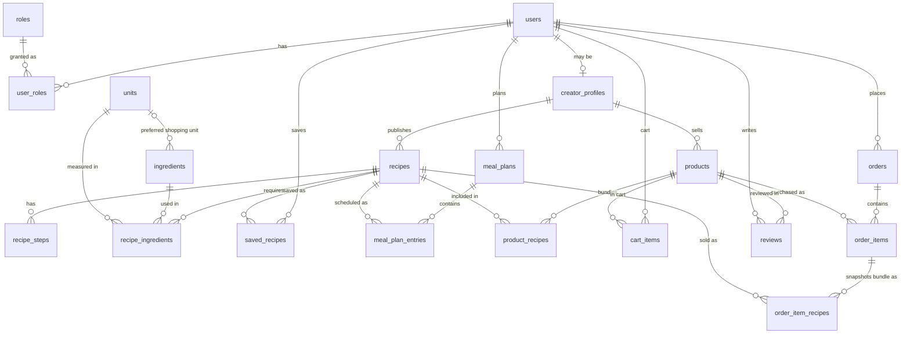

# Cookfeed — Assignment 2: Database Design Document

**Jeff Gulick** · Cookfeed: A Short-Video Recipe Marketplace · Deliverable 2 of the semester project

> **Revision after instructor feedback.** Section 3 is new: it states the marketplace business rules explicitly and answers each question raised in the review. The schema changes it required (a recipe `visibility`, a surrogate key on `product_recipes`, a checkout snapshot table `order_item_recipes`, and four triggers) are reflected in the sections that follow, in `docs/schema.sql`, `docs/sql/seed.sql`, and `docs/sql/queries.sql`. The deliberate denormalizations and the normalized model are unchanged.

---

## 1. Purpose and scope

Cookfeed is a short-video recipe marketplace: home cooks discover recipes through video, save them, turn saved and planned recipes into a single shopping list, and buy recipe collections and meal plans from creators. This deliverable is the data layer that everything else in the project stands on:

| Deliverable | Status | Where it lives |
|---|---|---|
| 1. ER diagram and normalized (3NF) schema | Done | `docs/ERDiagram.mermaid` (+ `.svg`, `.png`), `docs/EERDiagram.*`, `docs/ThirdNormalForm.*`, `docs/schema.sql` |
| 2. Seed data | Done | `docs/sql/seed.sql` |
| 3. Core queries, with the indexes that serve them | Done | `docs/sql/queries.sql` (reference SQL), `docs/Queries.md` |
| 4. Design document | Done | this file |
| 5. Schema as EF Core entities and migration | Done | `src/Cookfeed.Domain/Entities/*.cs`, `src/Cookfeed.Infrastructure/Persistence/CookfeedDbContext.cs`, `Persistence/Configurations/*.cs`, `Persistence/Migrations/` |
| 6. Seed data in C# | Done | `src/Cookfeed.Infrastructure/Persistence/Seed/DbSeeder.cs` and `SeedData.cs` (mirror `docs/sql/seed.sql`) |
| 7. Core queries in LINQ, generated SQL reviewed, indexes justified | Done | `src/Cookfeed.Infrastructure/Persistence/Repositories/*Repository.cs`; the logged SQL, query plans and index reasoning for each in `docs/Queries.md` |
| 8. ASP.NET Core API | Done for the four core queries | `src/Cookfeed.Api/Controllers/*Controller.cs` over the services in `src/Cookfeed.Application/` |
| 9. xUnit test suite | Done: 188 tests, passing | `tests/Cookfeed.Domain.Tests` (14), `tests/Cookfeed.Application.Tests` (20), `tests/Cookfeed.IntegrationTests` (154: 45 for the database, 109 for the API over HTTP) |
| 10. Continuous integration | Done | `.github/workflows/api-tests.yml`: every pull request that touches the API runs the build and all the tests on GitHub Actions |

Everything in this table is in the repository and runs today:

- **The database.** The EF Core migration builds the same database as `schema.sql`, `DbSeeder` loads the same rows as `seed.sql`, and the integration tests prove both on every run (see "Tests" below and `DOCKER.md`).
- **The API.** It serves the four core queries, each test-first and checked against the reference SQL in `queries.sql`:

  | Query | Endpoint |
  |---|---|
  | Feed | `GET /api/feed` |
  | Creator storefront | `GET /api/creators/{handle}` |
  | Order history | `GET /api/me/orders` |
  | Shopping list | `GET /api/me/shopping-list` |

- **Not yet built.** The write features (saves, cart, checkout, reviews) and the API-side business rules of §3 come with Assignment 4, together with login. Where this document says what "the API" does about them, it describes how they will be built; `docs/BuildLog.md` tracks them.

**Stack:** ASP.NET Core 10 Web API with controllers, EF Core 10, Npgsql, PostgreSQL 16, laid out as Clean Architecture. Table and column names use `snake_case` via the `EFCore.NamingConventions` package so the SQL reads naturally in `psql`. Angular (Assignment 4) will consume the API.

**API architecture.** Five projects, all created; each references only the ones listed before it, so the business rules at the centre never depend on EF Core or ASP.NET:

| Project | Holds | References |
|---|---|---|
| `Cookfeed.Domain` | Entities (one per table), enums, and pure business logic such as `ShoppingListAggregator` (§7.5) | nothing |
| `Cookfeed.Contracts` | Request and response DTOs: the API's public shape, which the Angular client mirrors | nothing |
| `Cookfeed.Application` | Services and the repository interfaces they depend on (`Abstractions/Persistence/`). Built: `FeedService`, `StorefrontService`, `OrderHistoryService`, `ShoppingListService`; the cart, checkout and review services come with the write features | Domain, Contracts |
| `Cookfeed.Infrastructure` | `CookfeedDbContext`, entity configurations, migrations (with the triggers), `DbSeeder`, and the repository implementations | Application, Domain, Contracts |
| `Cookfeed.Api` | Controllers (`FeedController`, `CreatorsController`, `MyOrdersController`, `MyShoppingListController`) and dependency-injection wiring. The caller comes from the `X-User-Id` header until login (§9); mapping database refusals to 4xx responses comes with the first write feature | Application, Contracts, Infrastructure (wiring only) |

A request runs controller → service → repository → EF Core. Controllers only translate HTTP: bind the request, call one service method, return the result. Services hold the business rules (§3) and the use-case logic. Repositories are the only classes that touch `CookfeedDbContext`. There is one per area rather than a generic `Repository<T>`, because the `DbContext` already provides generic add, find and save. Built: `RecipeRepository`, `CreatorRepository`, `OrderRepository` and `ShoppingListRepository`; areas such as the cart and reviews get theirs with the write features. Read methods project straight into `Contracts` DTOs, so the SQL in `docs/Queries.md` is what runs; write methods work with entities and save with a single `SaveChanges`, which EF Core wraps in one transaction (§6 relies on that for checkout).

**Tests.** All three test projects use xUnit, and each layer is tested at the level where its mistakes would show. 188 tests, all passing:

| Project | What it proves | How |
|---|---|---|
| `Cookfeed.Domain.Tests` (14) | `ShoppingListAggregator` applies the §7 policy: the flour example totals 1,032.91 g, milk converts toward millilitres, an ingredient without a density stays as two unmerged lines, count never merges with mass, the base-unit fallbacks, rounding and sorting | xUnit only; no database, no mocks |
| `Cookfeed.Application.Tests` (20) | The services' own rules: the feed's one-extra-row paging, the storefront's handle rule (ASCII letters, digits and hyphens, then lower-cased), the caller passed through for order history and the shopping list, and the aggregator's output reaching the response. The §3 write rules (no self-purchase in the cart, a review needs a `Paid` order, `ProductOnly` access, the checkout snapshot) get their tests here with those features | xUnit with NSubstitute fakes of the repository interfaces, so each rule is tested without a database |
| `Cookfeed.IntegrationTests` (154) | **The database:** the EF Core migration creates exactly the schema in `schema.sql` (tables, columns, indexes, check constraints, keys, triggers); `seed.sql` loads unchanged and Q1–Q16 return the same rows as on the `schema.sql` database; the four triggers and the delete rules refuse what §3 and §5 say they refuse; Q16 stays empty after save, unsave and account deletion; `DbSeeder` produces exactly the rows and id sequences of `seed.sql`. **The API over HTTP:** each endpoint returns what the reference queries return on the same database (Q1, Q2, Q3, Q5, Q8, Q9); ProductOnly recipes and drafts never reach the feed or storefront; the order-history snapshot survives a product rename; `orders.total_cents` equals the sum of its lines; the shopping list counts a ProductOnly recipe only once it is bought and never a draft; the `X-User-Id` header is parsed the same strict way on every route; bad input is a 400 and every error is a ProblemDetails body | xUnit against real PostgreSQL; each run creates throwaway databases and drops them afterwards. HTTP tests start the API in memory with `WebApplicationFactory<Program>` |

**Continuous integration.** `.github/workflows/api-tests.yml` runs on every pull request, and every push to `main`, that touches `CookFeed_api/`. Each run gets a fresh GitHub-hosted Ubuntu 24.04 machine and a `postgres:16.15` service container, the same version as `docker-compose.yml`, and takes about a minute. It has three steps:

1. Restore with `--locked-mode`, so a stale `packages.lock.json` fails the run.
2. Build, with warnings as errors.
3. Run all the tests.

The result shows as a check on the pull request, so a change that breaks a query, a rule or the schema is red before it reaches `main`.

The repositories are what make the middle project possible: because services depend only on repository interfaces, every business rule can be tested in milliseconds, and the slower integration tests are kept for what only a real database can prove.

**Why relational.** The two features the product is built around are joins and grouped aggregations. A shopping list is *"every ingredient across every recipe this user saved or planned, grouped by ingredient, summed"*. Order history is *"orders → order items → products → creators"*. Both are one `SELECT` with `JOIN`/`GROUP BY` in SQL and would be multi-round-trip application code over a document store. PostgreSQL also gives me `CHECK` constraints, real foreign keys, `numeric` for quantities, triggers, and `DELETE`-cascade semantics that encode business rules in the database rather than trusting every caller.

---

## 2. Entity-relationship diagram



The full attribute-level diagram is in `docs/ERDiagram.mermaid` (renders in GitHub, VS Code, and mermaid.live); `docs/ERDiagram.svg` and `.png` are rendered from it.

### Table inventory

| # | Table | Purpose | Key |
|---|---|---|---|
| 1 | `users` | Every account | `id` |
| 2 | `roles` | HomeCook / Creator / Admin lookup | `id` |
| 3 | `user_roles` | Many-to-many user↔role | `(user_id, role_id)` |
| 4 | `creator_profiles` | Storefront data; 1:1 with `users`, only for creators | `user_id` (shared PK) |
| 5 | `recipes` | The video + metadata; `visibility` says who may see it | `id` |
| 6 | `recipe_steps` | Ordered instructions, tied to video timestamps | `id`, unique `(recipe_id, step_number)` |
| 7 | `units` | Measurement units with category and base-conversion factor | `id` |
| 8 | `ingredients` | **Canonical** ingredient catalog with density | `id` |
| 9 | `recipe_ingredients` | Many-to-many recipe↔ingredient with quantity + unit | `id` |
| 10 | `saved_recipes` | User saved (liked) a recipe | `(user_id, recipe_id)` |
| 11 | `meal_plans` | One per user per week | `id`, unique `(user_id, week_start)` |
| 12 | `meal_plan_entries` | Recipe on a day/slot, optionally rescaled | `id` |
| 13 | `products` | Sellable collection or meal plan | `id` |
| 14 | `product_recipes` | The live contents of a product (+ day/slot for meal plans) | `id`, unique `(product_id, recipe_id, day_offset, slot)` nulls-not-distinct |
| 15 | `cart_items` | The cart, one row per product | `(user_id, product_id)` |
| 16 | `orders` | Order header | `id` |
| 17 | `order_items` | Purchased products with price/title snapshot | `id`, unique `(order_id, product_id)` |
| 18 | `order_item_recipes` | The product's recipes **as bought** — what the buyer is entitled to | `id`, unique `(order_item_id, recipe_id, day_offset, slot)` nulls-not-distinct |
| 19 | `reviews` | A user's star rating, recommendation and written review of a product (added in Assignment 3) | `id`, unique `(product_id, user_id)` |

The proposal estimated 12–14 tables; the submitted design had 17, Assignment 3 added `reviews`, and this revision adds `order_item_recipes`. The "extra" tables relative to the proposal are `units` (the proposal folded units into ingredients; §7 explains why that was wrong), `recipe_steps` (steps were going to be a text column; splitting them lets each step carry a video timestamp), `product_recipes` (a product must reference many recipes, which cannot be a column), and now `order_item_recipes` (§3.3: what was sold must not change when the product does). Nothing was added for its own sake — each table exists because a column could not hold the data without repeating groups, or because a fact had to survive a change to the row it was copied from.

**Assignment 3 addition: `reviews`.** The prototype's Reviews page shows a star rating, a recommend / do-not-recommend choice and written feedback for a product. None of the original 17 tables could hold that, so `reviews` was added. It stores `user_id`, not the reviewer's name, because the name already lives in `users.display_name` (3NF). The unique index on `(product_id, user_id)` allows one review per user per product. Rating is a `smallint` limited to 1–5 by `ck_reviews_rating_range`, and `body` is capped at 2000 characters, the same limits the prototype's form enforces in JavaScript.

---

## 3. Marketplace business rules

The review asked for the implications of the role model to be made explicit, and raised four follow-up points. This section answers each in turn and says where in the schema, seed, and queries the rule is enforced or demonstrated.

**What is built and what is planned:**
- **Built and tested:**
  - every rule the **database** enforces: the triggers, constraints and keys;
  - the shopping list's ProductOnly rule (§3.3).
- **Planned, with the write features:** the checks this section assigns to the **API**: the `HomeCook` role, the review rule, and access on recipe detail. They are listed with their endpoints in the `docs/BuildLog.md` API roadmap, and the prototype demonstrates them in the browser.

### 3.1 Who may do what

Three roles, held through `user_roles`:

| Role | Grants | Who holds it |
|---|---|---|
| `HomeCook` | save recipes, keep a cart, place orders, plan meals, write reviews | every ordinary account, granted at sign-up; **every creator**, so a creator shops like anyone else |
| `Creator` | publish recipes, sell products | accounts with a `creator_profiles` row; always together with `HomeCook` |
| `Admin` | operational access only | a dedicated account that holds **no other role** |

The answers to the questions as they were asked:

- **Are buying and saving available to every `User`, or dependent on holding the Home Cook role?** They depend on the role. The API will check `HomeCook` on every save, cart, checkout, meal-plan and review endpoint (`[Authorize(Roles = "HomeCook")]`, with login, roadmap item 12). This is why the seed grants `HomeCook` to every creator: without it a creator could publish but not shop. It also makes the admin rule below a consequence of the data rather than a special case in code.
- **May creators purchase one another's products?** Yes. Nothing distinguishes a creator-buyer from any other buyer. The seed has Dan (`dan-meal-preps`) buying Kenji's *Three Weeknights in Japan*; Q10's earnings report attributes it to Kenji because `order_items.creator_id` is always the seller.
- **May creators purchase their own products?** No. A row where the buyer is the product's creator is refused by the database at both points it could be created: `cart_items_refuse_self_purchase` (adding to cart) and `order_items_refuse_self_purchase` (the order line). The API will reject it earlier with a clear message (the cart, roadmap item 9); the triggers already guarantee that no caller can bypass it. Because reviews require a `Paid` order item for the product by the same user (API rule, §3.5), a creator can never review their own product either.
- **May administrators also participate as buyers and sellers?** No — admins are operational only. The `user_roles_admin_only` trigger refuses granting `Admin` to an account holding another role and refuses granting another role to an admin. Someone who both administers and cooks uses two accounts. In the seed the admin holds `Admin` alone, so the `HomeCook` check above will exclude it from every buying and saving endpoint automatically.

Where each lives: authorization rules (who may *act*) are enforced in the API's authorization layer, because that is the boundary where identity is known; data-integrity rules (which rows may *exist*) are enforced by triggers, because they must hold regardless of which caller writes the row. `queries.sql` Q17 demonstrates the refusals.

### 3.2 Can a meal plan use the same recipe on more than one day?

Yes — overnight oats on Monday and Thursday is a normal meal plan, and the original `(product_id, recipe_id)` key forbade it. `product_recipes` now has a surrogate `id`, and the one uniqueness rule that remains is "a recipe appears at most once per (product, day, slot)":

```sql
CREATE UNIQUE INDEX ix_product_recipes_product_id_recipe_id_day_offset_slot
    ON product_recipes (product_id, recipe_id, day_offset, slot) NULLS NOT DISTINCT;
CONSTRAINT ck_product_recipes_placement_pair CHECK ((day_offset IS NULL) = (slot IS NULL))
```

For a collection, `day_offset` and `slot` are both `NULL`; `NULLS NOT DISTINCT` (PostgreSQL 15+) makes the index treat those nulls as equal, so the same rule collapses to "a collection lists a recipe once". One index, one rule, both product types. The seed's *Family Week on a Budget* schedules Five-Day Overnight Oats on day 0 and day 3; Q5 now reports recipes (distinct, 5) and meals (rows, 6) separately for that reason.

### 3.3 What does a buyer keep, and what does buying add?

**What a buyer keeps.** Exactly what they bought. `order_item_recipes` copies `product_recipes` at checkout, one row per recipe in the bundle that day, with its day and slot. Every entitlement question — "which recipes does Priya own?" (Q11), "may Alex open this recipe?" (Q14) — reads the snapshot and never the live `product_recipes`. A creator editing a product changes what the *next* buyer receives and nothing about earlier buyers. Q15 shows the case directly: Alex's purchase of *Roman Pasta Collection* still includes *No-Knead Focaccia*, which Maria has since removed from the collection; the live product no longer has it, Alex still does, and a recipe Maria adds tomorrow would be in the product and not in Alex's purchase.

The snapshot also tightens the delete rules. `order_item_recipes.recipe_id` is `ON DELETE RESTRICT`, so a recipe anyone has paid for cannot be deleted even after the creator removes it from every live product (Q17e). The remedy for a creator who wants a recipe gone is `is_published = false`, which hides it from the feed and from new purchases while the buyers who already have it keep it.

**What buying adds.** The review correctly observed that if every recipe in a product is also in the free feed, the product sells only convenience. Two things change that:

1. **Content.** `recipes.visibility` is `'Public'` or `'ProductOnly'`. A `ProductOnly` recipe is published (`is_published = true` means the creator has finished it) but is absent from the feed, the trending list, the storefront's recipe list and search; it is reachable only by a buyer whose purchase snapshot contains it. `is_published` answers "is this a draft?"; `visibility` answers "who may see it?". The seed marks *Weeknight Chicken Parm* and *Onigiri Three Ways* `ProductOnly`; Q1–Q3 exclude them, Q14 shows which users may open them.
2. **The bundle.** A meal-plan product carries the day/slot arrangement, serving scale, and one combined shopping list for the whole week — the work of planning, which the feed does not do. A collection carries curation and sequencing. These are the `day_offset`, `slot` and `sort_order` columns, copied into the snapshot with the recipes.

A creator chooses the mix per recipe: a public recipe inside a product is a preview that drives sales; a product-only recipe is the reason to buy. Saving follows visibility: a user may save a `ProductOnly` recipe only if they can open it (API rule, same check as Q14).

### 3.4 Save counts

`recipes.save_count` must equal `COUNT(*) FROM saved_recipes WHERE recipe_id = ?` at all times. The submitted design kept it correct for ordinary saves and unsaves by incrementing in the same transaction, which left two gaps the review identified: the seed wrote counts in the hundreds against a handful of save rows, and account deletion cascaded the save rows away without touching the counter.

Both close by moving the rule into the database. A row-level trigger on `saved_recipes` (`saved_recipes_save_count`, §6) increments on `INSERT` and decrements on `DELETE`. Row-level triggers fire for rows removed by `ON DELETE CASCADE`, so a hard-deleted account (one with no orders) decrements every recipe it had saved. The seed no longer writes `save_count` at all; the trigger derives it from the save rows the seed inserts, so the counter cannot be wrong on the first commit. The seed gained four home-cook accounts so that the trigger-derived counts still produce a meaningful "Trending" order. Q16 is the consistency check (zero rows means every counter matches); the integration tests run it after seeding and after save, unsave, and account deletion.

Soft deletion (an account with orders, §5) keeps the `saved_recipes` rows, so the counts are unaffected: a save is a signal about the recipe, and anonymizing the user does not change that the recipe was saved.

### 3.5 Reviews

A review requires a `Paid` order item for the product by the same user. The API will check it on `POST /api/products/{id}/reviews` (roadmap item 11); the seed holds to it (Priya and Dan each buy *Three Weeknights in Japan* before reviewing it). Together with §3.1, this means a creator can neither buy nor review their own product. The rule is not a trigger because, unlike self-purchase, it is a policy that may loosen later (reviews from gifted copies, say); the authorization layer is the right place for a rule that may change.

### 3.6 The preferred-unit join (Q8)

The standalone shopping-list query converted *every* volume line with a known density to mass, then joined the result to the ingredient's preferred shopping unit on matching category. Liquids prefer millilitres, so their converted (`Mass`) lines could not join and were dropped — ten ingredients in the seed, including the milk. §7.4 describes the corrected rule; in short, the preferred unit now decides the *direction* of the conversion, and an ingredient that still cannot be expressed in its preferred unit falls back to its category's base unit instead of vanishing. Q8's output now agrees with the application's "unmerged" policy for exactly the ingredients where they previously differed.

### 3.7 What this means for the front end

The prototype (`CookFeed_frontend/prototype`) shows these rules for whichever seeded account is signed in. Each account starts from its own rows in the database (its cart, saves, orders and reviews), and the rules live in one file, `js/rules.js`, which every page asks before it draws a control:

| Rule | Section | What the screen shows |
|---|---|---|
| Shopping needs `HomeCook`; the admin holds no other role | §3.1 | The admin sees no cart, My kitchen, Your orders, Save, buy or review controls. A signed-out visitor sees "Sign in to ..." links instead. |
| A creator cannot buy their own product, but can buy anyone else's | §3.1 | Kenji's own plan reads "This is your plan" with no Add to cart; Maria's collection has one. |
| A meal plan may repeat a recipe | §3.2 | *Family Week on a Budget* reads "5 recipes, 6 meals", and its shopping list buys the oats for both mornings. |
| A buyer keeps the snapshot of what they bought | §3.3 | Checkout writes the order, its lines and the `order_item_recipes` snapshot; Your orders lists what each order holds. |
| A `ProductOnly` recipe opens only for a buyer | §3.3 | A non-buyer sees its card without a link, its ingredients stay off the plan's shopping list, and its page explains which plan it comes with. A buyer sees "Yours through *plan*". Storefronts and the trending list never show it. |
| Save counts follow the save rows | §3.4 | Every count is counted from the saves, so saving moves it by exactly one. |
| Only buyers review, once per product | §3.5 | The review form appears only for a buyer who has not reviewed the product yet, and posts under their account name. Anyone else is told why there is no form. |

**What the client does and does not decide.** The original note here said the admin rule would need no client-side role logic. That holds for enforcement: the API refuses every request the rules forbid, and the database refuses the rows that must never exist, whatever a client does. But a client that only reacted to refusals would offer the admin an Add to cart button that always fails. So the client also reads the rules, to decide what to *offer*: the same questions `rules.js` answers, asked of the caller's roles and purchases. The Angular client will get those answers from the API's DTOs (`ownedByViewer`, `viewerIsCreator`, `inCart` and the roles of the signed-in user), not by recomputing them.

One case the queries leave open, settled in the prototype: a creator can always open their own recipes, including `ProductOnly` ones and drafts. Q14 covers buyers only; the recipe-detail endpoint (`docs/BuildLog.md` roadmap item 3) will add the creator.

---

## 4. Normalization

The schema is in third normal form. Rather than restate the definitions, here are the places where 3NF forced a decision and what it was.

**Repeating groups removed (1NF).** A recipe has many steps and many ingredients. Both are child tables, not text blobs or JSON arrays. That is what makes ingredient aggregation possible at all: `recipe_ingredients` has one row per (recipe, ingredient) with a typed `numeric` quantity and a foreign key to a unit. A JSON `ingredients` column on `recipes` would have been faster to write and would have made the shopping list impossible in SQL.

**Partial dependencies removed (2NF).** In the junction tables with composite keys (`user_roles`, `saved_recipes`, `cart_items`) every non-key column depends on the whole key. `saved_at` depends on *this user saving this recipe*, not on the user or the recipe alone. `product_recipes` moved to a surrogate key in this revision (§3.2), but the same test holds: `day_offset`, `slot` and `sort_order` describe *this placement of this recipe in this product*. Nothing about the user or the recipe themselves lives in these tables.

**Transitive dependencies removed (3NF).** The clearest example is the unit. A recipe ingredient line says "2 cups". The fact that a cup is a *volume* unit of 236.588 ml depends on the unit, not on the recipe ingredient. So `unit_category` and `to_base_factor` live on `units`, and `recipe_ingredients` carries only `unit_id`. Likewise an ingredient's aisle category and density depend on the ingredient, so they live on `ingredients`, referenced by FK. A creator's handle and bio depend on the creator, not on each recipe they publish, so they live on `creator_profiles`.

**Decisions where normalization shaped the table list:**

- **`creator_profiles` is a separate 1:1 table, not columns on `users`.** Handle, bio, avatar, and verification status are null for the majority of users (home cooks). Splitting them out avoids a wide, mostly-null user row, gives `recipes.creator_id` and `products.creator_id` a foreign key that *guarantees the referenced user is a creator*, and keeps the storefront URL lookup (`handle`) on a small table. The shared primary key (`creator_profiles.user_id` is both PK and FK) enforces at-most-one profile per user without an extra unique index.

- **Roles are a junction table, not an enum column.** A creator is also a home cook — they save and buy like anyone else. A single `role` column would force a choice; `user_roles` lets one user hold both. §3.1 states which combinations are allowed.

- **There is no `carts` table.** A cart header would contain nothing but `user_id`. The cart *is* the set of `cart_items` rows for a user, keyed `(user_id, product_id)`. The composite key doubles as the rule "a product is in your cart once or not at all", which is correct for digital goods.

- **`order_items` has no `quantity`.** Products are digital (a collection, a plan). Buying one twice is meaningless, and the unique index on `(order_id, product_id)` enforces that. Dropping the column is more honest than a `quantity` that is always 1.

- **Products bundle recipes through `product_recipes`.** A meal-plan product is the same shape as a collection plus a `day_offset` and `slot` per recipe. One `products` table with a `type` discriminator and nullable placement columns was chosen over two tables because the cart, orders, and storefront treat both identically. `ck_product_recipes_day_offset_range` keeps the nullable columns honest, and `ck_product_recipes_placement_pair` makes `day_offset` and `slot` null or non-null together.

- **`visibility` is a column on `recipes`, not a flag on `product_recipes`.** Whether a recipe is public is a fact about the recipe: the same recipe in two products cannot be public in one and not the other. Putting it on the placement row would have created an update anomaly.

---

## 5. Constraints and referential integrity

Every relationship is a real foreign key. The delete behavior was chosen per relationship, not left at a default:

| Relationship | On delete | Reason |
|---|---|---|
| `users` → `user_roles`, `saved_recipes`, `meal_plans`, `cart_items`, `creator_profiles` | **CASCADE** | These rows are meaningless without the user; deleting an account should remove them. The `saved_recipes` cascade fires the save-count trigger (§3.4). |
| `users` → `orders` | **RESTRICT** | Financial history must survive. Account deletion must be handled as a soft delete / anonymization, not a hard delete. The database refuses to let the app get this wrong. |
| `creator_profiles` → `recipes`, `products` | CASCADE | A creator's catalog goes with their profile — which, through the two RESTRICTs below, can only happen once nothing of theirs has been sold. |
| `recipes` → `recipe_steps`, `recipe_ingredients`, `saved_recipes`, `meal_plan_entries` | CASCADE | Child rows of the recipe. |
| `recipes` ← `product_recipes` | **RESTRICT** | A recipe cannot be deleted out from under a live product. Remove it from the product first, or unpublish it. |
| `recipes` ← `order_item_recipes` | **RESTRICT** | A recipe somebody has paid for cannot be deleted at all, even after it leaves every live product. Unpublish it instead (`is_published = false`). |
| `ingredients`, `units` ← `recipe_ingredients` | **RESTRICT** | Catalog rows in use cannot be deleted. |
| `products` ← `order_items` | **RESTRICT** | Same reason: purchased products stay. Use `is_active = false`. |
| `products` → `product_recipes` | CASCADE | The live bundle goes with the product; buyers are unaffected because their copy is in `order_item_recipes`. |
| `products` ← `cart_items` | CASCADE | An unsold product vanishing from carts is fine. |
| `order_items` → `order_item_recipes` | CASCADE | The snapshot belongs to the order line, which itself cascades from the order. |
| `products`, `users` ← `reviews` | CASCADE | A review is meaningless without its product or its author. Products with sales are never hard-deleted (`order_items` RESTRICT), so in practice this only removes reviews of unsold products or of deleted accounts. |
| `roles` ← `user_roles` | RESTRICT | Roles are static lookup data. |
| `units` ← `ingredients.preferred_shopping_unit_id` | SET NULL | A preference, not a requirement; the shopping list falls back to the base unit. |

**Uniqueness** (all enforced by unique indexes, not application checks): `users.email`, `roles.name`, `creator_profiles.handle`, `units.name`, `units.abbreviation`, `ingredients.name`, `(recipe_id, step_number)`, `(user_id, week_start)` on meal plans, `(product_id, recipe_id, day_offset, slot)` nulls-not-distinct on `product_recipes` and the same shape on `order_item_recipes`, `(order_id, product_id)` on order items, `(product_id, user_id)` on reviews, plus every composite primary key.

**Check constraints** encode invariants that would otherwise be scattered across validation code:

```sql
ck_recipes_servings_positive                 servings > 0
ck_recipes_published_has_date                is_published = false OR published_at IS NOT NULL
ck_recipes_visibility                        visibility IN ('Public', 'ProductOnly')
ck_recipe_steps_number_positive              step_number > 0
ck_units_factor_positive                     to_base_factor > 0
ck_ingredients_density_positive              density_g_per_ml IS NULL OR density_g_per_ml > 0
ck_recipe_ingredients_quantity_positive      quantity > 0
ck_meal_plan_entries_servings_positive       servings_override IS NULL OR servings_override > 0
ck_product_recipes_day_offset_range          day_offset IS NULL OR day_offset BETWEEN 0 AND 6
ck_product_recipes_placement_pair            (day_offset IS NULL) = (slot IS NULL)
ck_order_item_recipes_day_offset_range       as above, on the snapshot
ck_order_item_recipes_placement_pair         as above, on the snapshot
ck_products_price_nonnegative                price_cents >= 0
ck_orders_total_nonnegative                  total_cents >= 0
ck_order_items_price_nonnegative             unit_price_cents >= 0
ck_creator_profiles_handle_slug              handle ~ '^[a-z0-9]+(?:-[a-z0-9]+)*$'
ck_reviews_rating_range                      rating BETWEEN 1 AND 5
```

`ck_recipes_servings_positive` matters more than it looks: the shopping list divides by `servings` to scale a recipe. A zero would be a division-by-zero in the query, so the database refuses it at insert.

**Triggers** cover the rules a `CHECK` cannot, because they compare rows across tables or maintain a derived value:

| Trigger | Table | Rule |
|---|---|---|
| `saved_recipes_save_count` | `saved_recipes`, after insert/delete, per row | keeps `recipes.save_count` equal to the save rows (§3.4, §6) |
| `cart_items_refuse_self_purchase` | `cart_items`, before insert/update | a creator cannot put their own product in their cart (§3.1) |
| `order_items_refuse_self_purchase` | `order_items`, before insert/update | a creator cannot buy their own product (§3.1) |
| `user_roles_admin_only` | `user_roles`, before insert/update | `Admin` is never held with another role (§3.1) |

The refusals raise `check_violation` with a named constraint (`ck_cart_items_no_self_purchase`, `ck_order_items_no_self_purchase`, `ck_user_roles_admin_only`) so the API can map them to a 4xx exactly as it maps a real `CHECK`. EF Core does not model triggers; they ship in the migration as raw SQL (`migrationBuilder.Sql(...)`), copied verbatim from `schema.sql`, and an integration test fails if the two ever differ.

**Types.** Money is integer cents (`price_cents`, `total_cents`, `unit_price_cents`) with a 3-letter `currency` column — never floating point. Quantities are `numeric(10,3)`; conversion factors `numeric(12,6)`; density `numeric(8,4)`. All timestamps are `timestamptz` stored in UTC; calendar dates (`week_start`, `planned_date`) are `date`, because "Monday the 21st" is not an instant. Enums (`unit category`, `meal slot`, `product type`, `order status`, `visibility`) are stored as short `varchar` rather than PostgreSQL enum types so that adding a value is an `INSERT`-compatible change rather than an `ALTER TYPE`, and so the values are readable in `psql`.

---

## 6. Where I chose to denormalize

Four deliberate departures from 3NF, each with the derivation rule and how it stays correct.

**1. `recipes.save_count`.** Derivable as `COUNT(*) FROM saved_recipes WHERE recipe_id = ?`. The feed is the most-read page in the application and the "Trending" sort orders by this number; computing it per row with a correlated subquery, then sorting, defeats any index. The counter is maintained by a row-level trigger on `saved_recipes` — an atomic `UPDATE recipes SET save_count = save_count ± 1` per save row, so concurrent saves cannot lose updates, cascaded deletes are counted, and the seed cannot write a count the save rows do not support (§3.4). The application inserts and deletes `saved_recipes` rows and never touches the counter. It is indexed together with `is_published` and `visibility` so the trending feed is an index scan.

**2. `orders.total_cents`.** Derivable as `SUM(unit_price_cents) FROM order_items`. Stored because an order total is a fact about a transaction that happened: if a line item were ever corrected or refunded independently, the original total should still be visible. It is written once at checkout and never updated. The integration tests assert it equals the sum of its items (`OrderHistoryEndpointTests`).

**3. `order_items.product_title`, `unit_price_cents`, `creator_id`.** These duplicate columns on `products`. They are **snapshots**: a creator can rename or reprice a product tomorrow, and order history must show what the buyer actually paid for, at the price they paid. `creator_id` is copied so that a creator-earnings report can group order items by creator without joining through `products` — and so it still works if a product is ever reassigned. This is the standard e-commerce pattern; the normalized alternative (a `product_versions` table) was more machinery than the project needs.

**4. `order_item_recipes`.** The same snapshot idea applied to the product's *contents*. Derivable from `product_recipes` only on the day of purchase; after that the live bundle may differ, and the question "what did this buyer get?" has no normalized answer without versioning every product. Written once at checkout in the same transaction as the order, never updated, and the only source the entitlement and access queries read (§3.3).

Not denormalized, on purpose: the shopping list. It is always computed from `saved_recipes` + `meal_plan_entries` + `recipe_ingredients`, never stored, because it changes with every save and every plan edit and is cheap to compute for one user.

---

## 7. The ingredient and unit model

This is the design problem the whole product hangs on. The requirement: a user saves a focaccia recipe calling for **500 g all-purpose flour**, a pancake recipe calling for **2 cups all-purpose flour**, and a cookie recipe calling for **2¼ cups flour**. The shopping list must show **one line: all-purpose flour, ~1,033 g** — not three.

Three separate problems are hiding in that sentence, and the model solves each with a separate mechanism.

### 7.1 "Which ingredient?" — canonical ingredients

Recipes never store ingredient names. `recipe_ingredients.ingredient_id` points at a single canonical row in `ingredients` (`name` is unique). "flour", "AP flour", and "all-purpose flour" on three recipes are three foreign keys to the same row, which is what lets `GROUP BY ingredient_id` work. What the creator actually typed is preserved in `recipe_ingredients.display_text` for the recipe page and is never used for aggregation.

*Deferred:* an `ingredient_aliases` table (`alias → ingredient_id`) so the creator-facing recipe editor can map free text to canonical rows automatically. The seed data maps ingredients directly; the alias table is an Assignment 3/4 concern and slots in without changing anything here.

### 7.2 "Are these the same kind of amount?" — unit categories and base units

Every unit belongs to exactly one **category** — `Volume`, `Mass`, or `Count` — and stores `to_base_factor`, its multiplier to that category's base unit (ml, g, or 1):

| unit | category | to_base_factor |
|---|---|---|
| teaspoon | Volume | 4.92892 |
| cup | Volume | 236.588 |
| millilitre | Volume | 1 |
| ounce | Mass | 28.3495 |
| gram | Mass | 1 |
| each, clove, can, bunch | Count | 1 |

Within a category, aggregation is purely arithmetic: `SUM(quantity × to_base_factor)`. This is done **in SQL**, grouped by `(ingredient_id, unit category)`. Adding a unit is an `INSERT` into `units`; no code changes.

Categories are not mixed by the database. "3 cloves garlic" and "15 g garlic" would come back as two groups for the same ingredient, and that is correct — count and mass are not interconvertible in general.

### 7.3 "Can volume and mass be reconciled?" — density

`ingredients.density_g_per_ml` is nullable. When present, volume and mass can be converted in either direction: `ml × density = g`, `g ÷ density = ml`. Flour is 0.53 g/ml, so 2 cups = 473.2 ml = 250.8 g, and the three flour lines above collapse:

```
500 g  (focaccia, already mass)
+ 2.00 cups × 236.588 × 0.53 = 250.78 g   (pancakes)
+ 2.25 cups × 236.588 × 0.53 = 282.13 g   (cookies)
= 1032.91 g
```

When density is unknown (`NULL`), the groups are **kept apart and shown separately** rather than guessed. The shopping list DTO returns them in an `unmerged` list so the UI can show "mozzarella — 200 g" and "mozzarella — 1 cup" as two lines. Wrong merges are worse than no merges: a user who buys half the cheese they need will not trust the list again.

### 7.4 "What unit should the line be in?" — preferred shopping unit, and the direction of conversion

`ingredients.preferred_shopping_unit_id` says how to present the aggregate: flour in grams, milk in millilitres, eggs by count. It does one more job that the submitted version got wrong: **it decides which way the density conversion runs.** Flour prefers grams, so its volume lines convert to mass. Milk prefers millilitres, so its *mass* lines (if a recipe said "200 g milk") convert to volume and its volume lines stay as they are. The earlier rule converted every dense volume line to mass unconditionally, which produced "milk: 975 g" — a quantity nobody shops for — and, in the standalone SQL (Q8), a line that could not be joined back to its millilitre preference and was dropped. Ten of the seed's ingredients, every liquid, disappeared from the list that way.

The corrected rule, in one sentence: *convert toward the preferred unit's category when density allows; otherwise leave the line in its own category.* After merging, the base quantity is divided by the preferred unit's `to_base_factor`. If the preferred unit's category still differs from the line's (an ingredient with only Count rows but a Mass preference, or no preferred unit at all), the line is presented in the base unit of whatever category it has — ml, g or each — rather than dropped. An ingredient with two irreconcilable categories gets two lines. The seed's Q8 output for Alex now has 41 lines where it had 31.

### 7.5 Division of labor: SQL vs. application

```
SQL  (one query, GROUP BY)             C#  (per ingredient, in memory)
─────────────────────────────          ───────────────────────────────
which recipes, at what scale     →     Volume<->Mass via density, toward the preferred unit
JOIN recipe_ingredients          →     choose main vs unmerged lines
× to_base_factor, SUM by         →     express in preferred unit, or fall back to base
(ingredient, unit category)      →     round, sort by aisle
```

The database does the part that benefits from being close to the data: the join and the sum over potentially hundreds of rows. The application does the part that is a *policy* — when to merge, which way, when to refuse, how to present — because policies change and are far easier to unit-test in C# than in SQL.

**As built:**

- **The SQL half** is one statement in `ShoppingListRepository` (`docs/Queries.md` §3). It returns one `IngredientTotal` per (ingredient, unit category), already scaled and in the category's base unit.
- **The preferred unit travels with each total** through a `LEFT JOIN`, so the C# half needs no separate lookup of the `units` table.
- **The C# half** is `ShoppingListAggregator` in `Cookfeed.Domain`: pure, no EF Core.
- **Its tests** in `tests/Cookfeed.Domain.Tests` pin each rule without a database: the flour example to 1,032.91 g, milk to millilitres, mozzarella with no density kept as two unmerged lines, count never merging with mass, and the base-unit fallbacks.
- **Rounding** is to two places, half away from zero as PostgreSQL's `ROUND` does. **Sorting** is by aisle, then ingredient.

`docs/sql/queries.sql` Q8 implements the whole algorithm in SQL (41 lines for Alex, flour 1,032.91 g, milk 946.35 ml). `ShoppingListEndpointTests` holds the API to it line for line: for every plan, for a single week, and with a recipe planned on two nights.

Two things learned from reading the SQL EF Core generated, both recorded in `docs/Queries.md` §3:

- **Explicit joins in the grouped query.** Summing through navigations made EF Core run a correlated subquery per output line, so the repository joins explicitly.
- **Rounding inside the sum.** PostgreSQL's exact division of the serving scale can carry more digits than a .NET `decimal` holds, so each line is rounded to six places inside the `SUM`.

The "which recipes is this line from" labels are deferred. They need a second, flat query and do not change this one.

### 7.6 Scaling

A meal plan entry can override servings: Alex plans a 2-serving teriyaki for 4 people. The recipe set query computes `scale = servings_override / recipe.servings` per entry and multiplies every ingredient quantity by it in the same `SUM`. Saved-but-not-planned recipes scale at 1. A recipe that is both saved and planned counts once, at the planned scale (`NOT EXISTS` against the planned set). A recipe planned on two different nights counts twice — you are cooking it twice. Only recipes the user may open count at all: published, and Public or in one of their Paid purchases (§3.3, the Q14 rule), so a ProductOnly recipe saved before buying, a refunded purchase, or a draft adds no ingredients. These rules are each covered by a test.

---

## 8. Indexing summary

Every read-side query is paired with the index that serves it in `docs/Queries.md`. The short version:

- **Feed:** `(is_published, visibility, published_at DESC)` and `(is_published, visibility, save_count DESC)` — the `WHERE is_published AND visibility = 'Public' ORDER BY … LIMIT` shape becomes a forward index scan that stops after one page. Both leading columns are equality predicates, so the ordered column still serves the sort.
- **Storefront:** unique `handle`; `recipes(creator_id)`; `products(creator_id, is_active)`; `product_recipes(product_id, sort_order)` returns a bundle in display order.
- **Shopping list:** composite PK `saved_recipes(user_id, recipe_id)`; unique `meal_plans(user_id, week_start)`; `meal_plan_entries(meal_plan_id, planned_date, slot)`; `recipe_ingredients(recipe_id, sort_order)`.
- **Order history and entitlements:** `orders(user_id, placed_at DESC)`; unique `order_items(order_id, product_id)`; the nulls-not-distinct unique on `order_item_recipes(order_item_id, …)` serves the "recipes in this purchase" join through its leading column, and `order_item_recipes(recipe_id)` serves the reverse question "does this user own this recipe?" (Q14).
- **Reviews page:** `reviews(product_id, created_at DESC)` returns a product's reviews newest first; the unique `(product_id, user_id)` index enforces one review per user; `reviews(user_id)` supports the foreign key.
- **Every foreign key** has a supporting index so `RESTRICT`/`CASCADE` checks and reverse lookups ("recipes using this ingredient", "who bought this product") do not table-scan. PostgreSQL does not create these automatically; EF Core does, and the reference DDL lists them explicitly.

No index was added speculatively. Each one corresponds to a `WHERE`, `JOIN`, or `ORDER BY` in a real query in this repository.

---

## 9. Deliberately out of scope for this assignment

- **Authentication.** `password_hash` is stored (never plaintext), but login, JWTs, and authorization arrive with the Angular work in Assignment 4. Until then the API takes the caller from an `X-User-Id` header, and the role checks in §3.1 will be applied against that identity until real authentication replaces it. Two conventions are fixed now so that login changes nothing else:
  - **A user's own data lives under `/api/me/…`** (`/api/me/orders`, `/api/me/shopping-list`). No route takes a user id, so no request can name another user's data, whatever the caller sends. On these routes the header is required. An id that names no user simply has no data, so it gets an empty result and learns nothing.
  - **On public routes** (the feed, storefronts) the header is optional and only marks the caller's own state (`savedByViewer`, `ownedByViewer`, `viewerIsCreator`).
  - **One parser for every route** (`CallerIdModelBinder`): the value must be a whole number of 1 or more in plain digits. `0`, a negative number, hex (`0x1`), a leading `+`, or an empty or repeated header is a 400 on public routes too, rather than being read as "anonymous" or as another user.

  When login arrives, ASP.NET Core's JWT authentication sets the caller from the token's user-id claim, the controllers read it from there instead of the header, and the routes, services, repositories and queries stay as they are. Building a custom header-authentication handler now was considered and rejected: it would be deleted then.
- **Payments.** Checkout creates a `Paid` order with a simulated `payment_reference`. A Stripe-style provider would move the order through `Pending → Paid` and populate the reference.
- **Ingredient aliases and creator-side ingredient entry** (§7.1).
- **Video storage.** `video_url` is a URL; upload/transcoding is infrastructure, not schema.
- **Refunds and gifting.** `order_item_recipes` already answers "does this user own this recipe?" with one `EXISTS` (Q14). A refund would set `orders.status = 'Refunded'`, and the same query excludes it because it filters on `Paid`. Gifting would need a recipient column on `orders`; nothing else changes.
